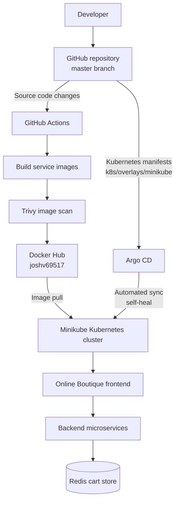
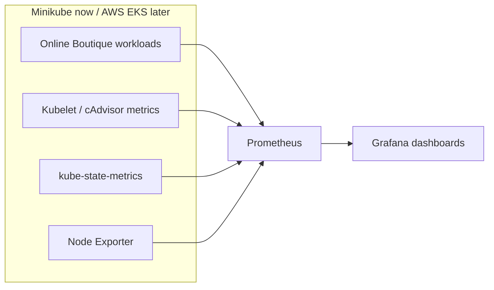

# Online Boutique — CI/CD, Kubernetes & GitOps

A hands-on DevOps project that packages the Online Boutique microservices application into container images, publishes them through GitHub Actions, deploys the workloads to Kubernetes, and manages the deployment with Argo CD GitOps.

> **Project status (November 2026):** The local Minikube deployment and Argo CD GitOps workflow have been deployed and verified. Prometheus/Grafana monitoring is documented as a future phase and is **not currently installed**. AWS EKS is a planned future deployment; the AWS infrastructure is **not currently running**.

[](https://github.com/JOSH801251/online-boutique-eks/actions/workflows/build-and-push.yml)

---

## Contents

- [Project overview](#project-overview)
- [Implementation status](#implementation-status)
- [Technology stack](#technology-stack)
- [Architecture](#architecture)
- [Application services](#application-services)
- [CI/CD workflow](#cicd-workflow)
- [Kubernetes deployment on Minikube](#kubernetes-deployment-on-minikube)
- [Argo CD GitOps](#argo-cd-gitops)
- [GitOps self-healing test](#gitops-self-healing-test)
- [Security and reliability practices](#security-and-reliability-practices)
- [Monitoring roadmap](#monitoring-roadmap)
- [AWS EKS and Terraform roadmap](#aws-eks-and-terraform-roadmap)
- [Repository structure](#repository-structure)
- [Troubleshooting commands](#troubleshooting-commands)
- [Screenshots and evidence](#screenshots-and-evidence)
- [Future improvements](#future-improvements)

## Project overview

This repository demonstrates a practical delivery workflow for a multi-service application:

1. Build container images for the application services.
2. Scan container images as part of the CI workflow.
3. Publish versioned images to Docker Hub.
4. Define Kubernetes workloads and services as declarative YAML.
5. Use Kustomize to apply a Minikube-specific overlay.
6. Use Argo CD to continuously compare the Git repository with the live Kubernetes cluster and synchronize changes.

The application was deployed locally to Minikube using the Docker driver. The storefront was opened through a Kubernetes port-forward, and the application shopping flow was manually tested in the browser.

## Implementation status

| Area | Status | Notes |
|---|---|---|
| Containerization | **Implemented** | Dockerfiles and versioned service images are used. |
| CI/CD | **Implemented** | GitHub Actions workflow builds and publishes service images; successful workflow runs have been observed. |
| Image security scanning | **Configured in CI** | Trivy is part of the image workflow. Review the workflow for the current scan policy and results. |
| Kubernetes manifests | **Implemented** | Base manifests define application Deployments and Services. |
| Minikube deployment | **Deployed and verified** | Application workloads and Redis were running; storefront access was verified. |
| Kustomize | **Implemented** | Minikube overlay removes the AWS ingress and applies local probe adjustments. |
| Argo CD | **Deployed and verified** | `online-boutique` is registered from this repository and has reached `Synced` / `Healthy`. |
| GitOps self-healing | **Demonstrated** | A manual frontend replica change was reconciled back to the Git-defined replica count. |
| Prometheus / Grafana | **Planned — not deployed** | Design and manifests can be added later when local memory capacity allows. |
| AWS EKS | **Planned — not deployed** | Terraform configuration exists in the repository, but the AWS cluster and supporting infrastructure are not currently running. |

## Technology stack

| Category | Tools |
|---|---|
| Source control | Git, GitHub |
| CI/CD | GitHub Actions |
| Containers | Docker |
| Image registry | Docker Hub (`joshv69517`) |
| Image scanning | Trivy |
| Container orchestration | Kubernetes, Minikube |
| Manifest management | Kustomize |
| GitOps | Argo CD |
| Infrastructure as Code | Terraform (AWS deployment planned) |
| Future observability | Prometheus and Grafana (planned; not deployed) |

## Architecture

### Implemented local delivery architecture



The CI workflow builds and publishes container images. Argo CD separately manages Kubernetes manifests from the Git repository. The workflow does not mean that GitHub Actions directly deploys the application to AWS; the verified GitOps destination in this phase is the local Minikube cluster.

### Planned monitoring architecture

The following is a **design concept only**. These monitoring components have not been installed in the current Minikube cluster.



## Application services

The Kubernetes configuration is based on the Online Boutique microservices application. The repository includes manifests and image references for the following workloads:

| Workload | Purpose |
|---|---|
| `frontend` | Web storefront and user interface |
| `adservice` | Advertisement recommendations |
| `cartservice` | Shopping cart operations |
| `checkoutservice` | Checkout orchestration |
| `currencyservice` | Currency conversion |
| `emailservice` | Email notifications (dummy mode in this demonstration) |
| `paymentservice` | Payment processing demonstration |
| `productcatalogservice` | Product catalogue |
| `recommendationservice` | Product recommendations |
| `shippingservice` | Shipping quote and order shipping logic |
| `loadgenerator` | Synthetic load generation; kept disabled in the lightweight local configuration |
| `redis-cart` | Redis backing service for cart data |

The application service images use the `v0.10.6` tag in the current manifests. Redis uses `redis:7.4.12-alpine`.

## CI/CD workflow

The GitHub Actions workflow is located at:

```text
.github/workflows/build-and-push.yml
```

At a high level, the workflow:

1. Runs for configured source/workflow changes on the `master` branch.
2. Builds container images for the service matrix.
3. Runs the configured Trivy image scan.
4. Authenticates to Docker Hub using GitHub Actions secrets.
5. Publishes the versioned images to Docker Hub.

### Required GitHub Actions secrets

Configure these repository secrets before running the workflow in a new fork:

| Secret | Purpose |
|---|---|
| `DOCKERHUB_USERNAME` | Docker Hub username |
| `DOCKERHUB_TOKEN` | Docker Hub access token (use a token, not your account password) |

Do not commit credentials, access tokens, kubeconfig files, Terraform state, or `.tfvars` files to the repository.

### Check workflow runs

```bash
gh run list --repo JOSH801251/online-boutique-eks --limit 10
```

Open the **Actions** tab in GitHub to inspect job logs, scan results, and published image steps.

## Kubernetes deployment on Minikube

### Prerequisites

- Windows 11 or another supported operating system
- Docker Desktop with the Docker engine running
- Minikube
- `kubectl`
- Git

The local environment used for this project had limited RAM. The Minikube overlay keeps the local deployment lean, including disabling the load generator. Avoid adding resource-heavy monitoring components to a laptop with insufficient free memory.

### Start Minikube

```bash
minikube start --driver=docker
minikube status
kubectl get nodes
```

### Deploy the Minikube overlay

For a first-time manual deployment (before Argo CD takes ownership of the application):

```bash
kubectl apply -k k8s/overlays/minikube
```

The overlay:

- Creates/uses the `online-boutique` namespace.
- Uses the Minikube-specific workload configuration.
- Removes the AWS-specific ingress resource for local use.
- Applies startup, liveness, and readiness probe adjustments for `emailservice` and `recommendationservice` to better tolerate local startup delays.
- Keeps the local workload configuration lightweight.

Check workloads and services:

```bash
kubectl get pods -n online-boutique
kubectl get services -n online-boutique
kubectl get deployments -n online-boutique
```

### Open the storefront

The frontend Service is a ClusterIP service. Use port-forwarding to access it from the host:

```bash
kubectl port-forward -n online-boutique svc/frontend 8080:80
```

Keep that terminal open and browse to:

```text
http://localhost:8080
```

Stop the port-forward with `Ctrl+C` when finished.

## Argo CD GitOps

The Argo CD Application definition is stored at:

```text
gitops/online-boutique-application.yaml
```

It points Argo CD to:

- Repository: `https://github.com/JOSH801251/online-boutique-eks.git`
- Revision: `master`
- Path: `k8s/overlays/minikube`
- Destination namespace: `online-boutique`

Automated sync is configured with pruning and self-healing enabled. The namespace is created automatically when required.

### Register the Application

This assumes Argo CD is already installed in the `argocd` namespace and can access the GitHub repository.

```bash
kubectl apply -f gitops/online-boutique-application.yaml
kubectl get applications -n argocd
```

Expected application status after reconciliation:

```text
NAME              SYNC STATUS   HEALTH STATUS
online-boutique   Synced        Healthy
```

### Open the Argo CD dashboard

Run this in a separate terminal:

```bash
kubectl port-forward svc/argocd-server -n argocd 8081:443
```

Browse to:

```text
https://localhost:8081
```

For a local self-signed certificate warning, verify that the address is `localhost` before choosing the browser's proceed option. Use your configured Argo CD admin credentials. Do not publish the password in screenshots or documentation.

### Inspect the Application

```bash
kubectl get application online-boutique -n argocd
kubectl describe application online-boutique -n argocd
```

## GitOps self-healing test

Self-healing was demonstrated by changing the live frontend replica count while the Git repository declared the desired count as one replica.

Git-defined desired state:

```yaml
spec:
  replicas: 1
```

Test procedure:

```bash
# Introduce a temporary drift in the live Deployment.
kubectl scale deployment frontend -n online-boutique --replicas=2

# Ask Argo CD to refresh its comparison.
kubectl annotate application online-boutique -n argocd \
  argocd.argoproj.io/refresh=hard --overwrite

# Verify that Argo CD restores the Git-defined replica count.
kubectl get deployment frontend -n online-boutique \
  -o jsonpath='Desired={.spec.replicas} Ready={.status.readyReplicas}{"\n"}'

kubectl get application online-boutique -n argocd
```

The verified result was `Desired=1 Ready=1`, with the Argo CD Application reporting `Synced` and `Healthy` after reconciliation.

## Security and reliability practices

- Use GitHub Actions secrets for Docker Hub authentication.
- Keep secrets, tokens, private keys, kubeconfig files, Terraform state, and local variable files out of Git.
- Use non-root container security contexts, dropped Linux capabilities, and read-only root filesystems where defined by the service manifests.
- Use Kubernetes readiness and liveness probes; the Minikube overlay adds startup probes for services that needed longer local startup tolerance.
- Use a Minikube-specific Kustomize overlay so local configuration does not replace the shared base manifests.
- Review image scan findings and update dependencies/base images before publishing new image tags.

## Monitoring roadmap

**Prometheus and Grafana are not deployed in this project phase.** The laptop used for the local cluster had approximately 7.35 GB of visible RAM, with about 0.55 GB free during the monitoring planning step. To avoid destabilizing the running application and Argo CD, the monitoring installation was deferred.

The planned monitoring stack is:

| Component | Planned responsibility | Status |
|---|---|---|
| Prometheus | Scrape and store metrics | Not deployed |
| Node Exporter | Host-level CPU, memory, filesystem metrics | Not deployed |
| kube-state-metrics | Kubernetes object and workload state metrics | Not deployed |
| Kubelet / cAdvisor | Container and node metrics | Not configured for this project |
| Grafana | Dashboards and visualization | Not deployed |

Potential dashboards include node CPU/memory, pod readiness, Deployment availability, container restarts, and per-service resource usage. Any generated dashboard artwork in the repository should be explicitly labeled **illustrative mockup — not deployed** until it is replaced with real screenshots from a running monitoring stack.

## AWS EKS and Terraform roadmap

Terraform configuration is present in the repository for a future AWS deployment. The AWS EKS environment is **not currently provisioned**. The earlier AWS environment was destroyed to avoid ongoing costs, so do not treat this project as a live EKS deployment.

The intended future AWS phase is to:

1. Review and validate Terraform providers, variables, modules, and state backend.
2. Re-check AWS account permissions, quotas, budget alerts, and region.
3. Provision VPC networking and public/private subnets.
4. Provision EKS and managed worker nodes.
5. Configure IAM roles and workload identity for cluster add-ons.
6. Install the AWS Load Balancer Controller and configure the AWS ingress path.
7. Deploy Argo CD and point it at the EKS-specific configuration.
8. Add monitoring only after confirming cluster capacity and operating cost.

Before running Terraform, review the plan and estimated AWS costs. NAT Gateways, EKS control planes, EC2 instances, load balancers, public IPv4 addresses, and storage can incur charges. Never run `terraform apply` without inspecting the plan and confirming the budget.

## Repository structure

```text
online-boutique-eks/
├── .github/
│   └── workflows/
│       └── build-and-push.yml
├── gitops/
│   └── online-boutique-application.yaml
├── k8s/
│   ├── base/
│   │   ├── service and Deployment manifests
│   │   └── ingress.yaml
│   └── overlays/
│       └── minikube/
│           ├── kustomization.yaml
│           ├── namespace.yaml
│           ├── remove-aws-ingress.yaml
│           ├── emailservice-probes.yaml
│           └── recommendationservice-probes.yaml
├── src/
│   └── application microservices
├── terraform/
│   ├── addons/
│   └── argocd/
├── docs/
│   └── images/
└── README.md
```

Some directories may contain additional files not shown in this abbreviated tree.

## Troubleshooting commands

| Task | Command |
|---|---|
| Check Minikube | `minikube status` |
| Check Kubernetes nodes | `kubectl get nodes` |
| List application pods | `kubectl get pods -n online-boutique` |
| List application Services | `kubectl get svc -n online-boutique` |
| Inspect a Deployment | `kubectl describe deployment <name> -n online-boutique` |
| View current logs | `kubectl logs deployment/<name> -n online-boutique` |
| View previous crashed-container logs | `kubectl logs deployment/<name> -n online-boutique --previous` |
| Inspect namespace events | `kubectl get events -n online-boutique --sort-by=.lastTimestamp` |
| Check resource usage | `kubectl top pods -n online-boutique` |
| Check Argo CD Application | `kubectl get applications -n argocd` |
| Inspect Argo CD Application | `kubectl describe application online-boutique -n argocd` |

## Screenshots and evidence

Store real screenshots under `docs/images/`. Capture them from the running tools; do not use generated mockups as evidence of a live deployment.

Suggested evidence files:

| File | Evidence to capture |
|---|---|
| `docs/images/online-boutique-storefront.png` | Working storefront in the browser |
| `docs/images/argocd-applications.png` | Argo CD Applications page showing `online-boutique` as Synced and Healthy |
| `docs/images/argocd-self-healing.png` | Terminal output showing frontend restored to one ready replica and Argo CD Synced/Healthy |
| `docs/images/github-actions-success.png` | Successful GitHub Actions run and completed jobs |
| `docs/images/monitoring-architecture.png` | Planned monitoring architecture diagram; mark as not deployed |
| `docs/images/prometheus-dashboard-mockup.png` | Illustrative Prometheus dashboard mockup; mark as not deployed |
| `docs/images/grafana-dashboard-mockup.png` | Illustrative Grafana dashboard mockup; mark as not deployed |

When the actual screenshot files have been added, embed them in this section using standard Markdown image links. Until then, the table intentionally documents the expected evidence without creating broken image links.

## Future improvements

- Complete a resource-aware Prometheus and Grafana installation when sufficient local or cloud capacity is available.
- Add alert rules for pod restarts, unavailable Deployments, node pressure, and service health.
- Add an EKS-specific Kustomize overlay and validate it against the Terraform-created cluster.
- Add automated deployment validation and smoke tests after GitOps synchronization.
- Add policy checks and dependency/image vulnerability remediation to the CI workflow.
- Capture real operational screenshots and keep all project claims aligned with what has actually been deployed and tested.

---

## Maintainer

**Josh**  
GitHub: [@JOSH801251](https://github.com/JOSH801251)  
Repository: [online-boutique-eks](https://github.com/JOSH801251/online-boutique-eks)

This repository is maintained as a learning and portfolio project. The implementation status above distinguishes verified local functionality from planned cloud and monitoring work.
