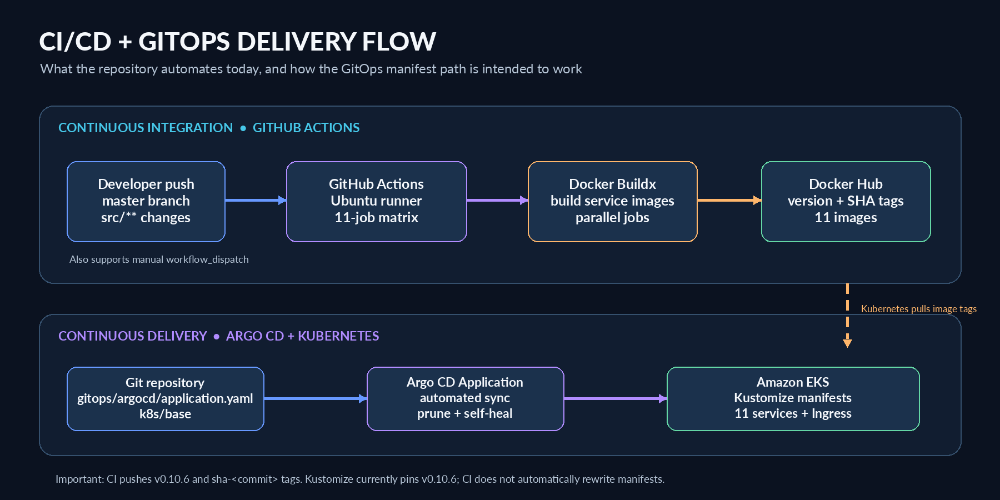
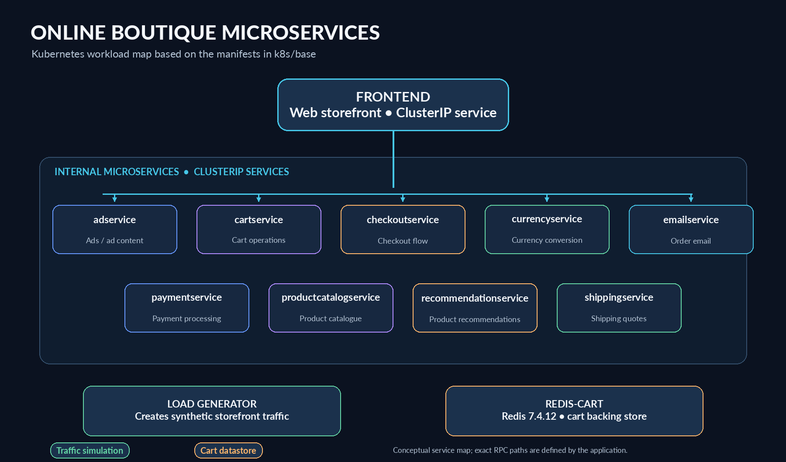
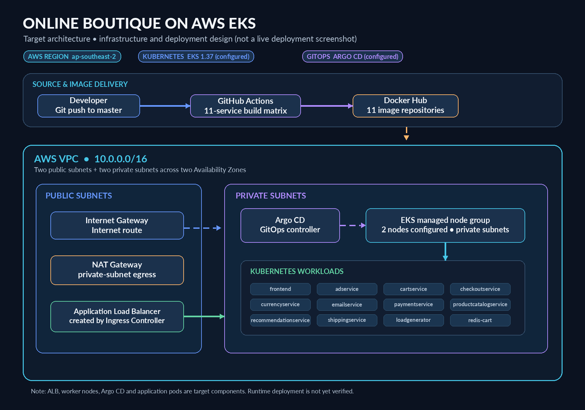

# Online Boutique on Amazon EKS

A DevOps portfolio project built around Google's **Online Boutique microservices demo**. It uses Docker and GitHub Actions to build and publish service images, Kubernetes and Kustomize to define workloads, and Argo CD to implement GitOps deployment and self-healing on a local Minikube cluster.

The repository also contains Terraform configurations and an AWS EKS target architecture for a later cloud deployment.

> **Current implementation status**
>
> - **Implemented and verified locally:** Docker image build/push workflow, Kubernetes deployment on Minikube, Kustomize Minikube overlay, Argo CD automated synchronization, and a self-healing test.
> - **Not deployed at present:** Prometheus/Grafana monitoring and the AWS EKS environment. Prometheus and Grafana are documented as planned work; AWS EKS is a future deployment target.
> - **AWS cleanup:** The temporary AWS test environment was destroyed after validation. The repository's Terraform code remains available for a future deployment after the account and node-type constraints are resolved.

---

## Contents

- [Project overview](#project-overview)
- [Implementation status](#implementation-status)
- [Architecture](#architecture)
- [Application services](#application-services)
- [Technology stack](#technology-stack)
- [Repository layout](#repository-layout)
- [CI: build and push container images](#ci-build-and-push-container-images)
- [Kubernetes and Kustomize](#kubernetes-and-kustomize)
- [GitOps with Argo CD](#gitops-with-argo-cd)
- [Local deployment on Minikube](#local-deployment-on-minikube)
- [Validation and operational commands](#validation-and-operational-commands)
- [AWS EKS and Terraform target](#aws-eks-and-terraform-target)
- [Monitoring roadmap](#monitoring-roadmap)
- [Known limitations and next steps](#known-limitations-and-next-steps)
- [Cleanup](#cleanup)
- [Source attribution](#source-attribution)

---

## Project overview

The project demonstrates a containerized microservices application delivered through a CI workflow and managed on Kubernetes using GitOps.

The implemented delivery flow is:

1. A source-code or workflow change triggers GitHub Actions.
2. A matrix workflow builds the eleven service images.
3. The images are pushed to Docker Hub.
4. Kubernetes manifests describe the desired application state.
5. Argo CD watches the Git repository and reconciles the Minikube environment against the manifests.
6. Argo CD automated sync, pruning, and self-healing keep the cluster aligned with Git.

The current local environment was verified with the storefront accessible through Kubernetes port-forwarding. The frontend Service remains a ClusterIP Service; no public load balancer is used in the Minikube environment.

## Implementation status

| Capability | Status | Notes |
|---|---|---|
| Docker image build and Docker Hub push | Implemented | GitHub Actions matrix workflow for eleven images |
| Kubernetes application deployment | Implemented | Validated on Minikube |
| Kustomize environment overlay | Implemented | `k8s/overlays/minikube` |
| Argo CD GitOps | Implemented | Watches `master` and the Minikube overlay |
| Automated sync and self-healing | Demonstrated | Manual frontend replica drift was reconciled back to the Git-defined value |
| Prometheus and Grafana | Planned | Not installed in the current local cluster |
| AWS VPC and EKS deployment | Planned / Terraform configured | No active project EKS environment remains |

## Architecture

### Implemented local architecture

The following diagram describes the implemented CI/CD and GitOps flow:

The local deployment uses:

- Minikube as the Kubernetes environment.
- Docker Hub as the image registry.
- Kustomize to compose the base Kubernetes resources with Minikube-specific changes.
- Argo CD to watch `k8s/overlays/minikube` on the `master` branch.
- A ClusterIP frontend Service exposed locally with `kubectl port-forward`.

### Application service map

### Future AWS architecture

The Terraform configuration describes a target AWS design. It is **not a currently running AWS environment**.

The current Terraform design is configured around:

- AWS Region: `ap-southeast-2` (Sydney).
- VPC CIDR: `10.0.0.0/16`.
- Two public and two private subnets across Availability Zones.
- Internet Gateway and a shared NAT Gateway.
- An Amazon EKS cluster and managed node group.
- AWS Load Balancer Controller integration using the current IRSA design.
- Argo CD installed through a separate Terraform root.

The design is intended for a future cloud deployment after the account-level restrictions and worker-node selection are addressed.

## Application services

The Docker build matrix contains the following eleven service images:

| Service | Responsibility |
|---|---|
| `frontend` | Web storefront and user interface |
| `adservice` | Advertisement content |
| `cartservice` | Shopping cart operations |
| `checkoutservice` | Checkout coordination |
| `currencyservice` | Currency conversion |
| `emailservice` | Order-related email notifications in the demo |
| `paymentservice` | Demo payment processing |
| `productcatalogservice` | Product catalogue data |
| `recommendationservice` | Product recommendations |
| `shippingservice` | Shipping quotes |
| `loadgenerator` | Synthetic storefront traffic |

The cart service uses a separate `redis-cart` Deployment and Service. The Redis data directory uses an `emptyDir` volume in the current manifest, so its data is ephemeral and is not durable production storage.

## Technology stack

| Area | Technology |
|---|---|
| Application | Google Online Boutique / microservices demo |
| Containers | Docker, Docker Buildx |
| Image registry | Docker Hub |
| CI | GitHub Actions |
| Orchestration | Kubernetes, Minikube |
| Kubernetes packaging | Kustomize |
| GitOps | Argo CD |
| Infrastructure as Code | Terraform |
| Planned cloud platform | Amazon VPC and Amazon EKS |
| Planned ingress for AWS | AWS Load Balancer Controller and ALB |
| Current basic metrics | Kubernetes Metrics Server (`kubectl top`) |
| Planned observability | Prometheus and Grafana (not deployed) |

## Repository layout

~~~text
online-boutique-eks/
├── .github/
│   └── workflows/
│       └── build-and-push.yml
├── gitops/
│   └── online-boutique-application.yaml
├── k8s/
│   ├── base/
│   │   ├── kustomization.yaml
│   │   └── service and ingress manifests
│   └── overlays/
│       └── minikube/
│           ├── kustomization.yaml
│           ├── namespace.yaml
│           ├── remove-aws-ingress.yaml
│           ├── emailservice-probes.yaml
│           └── recommendationservice-probes.yaml
├── scripts/
│   └── dependency maintenance helpers
├── src/
│   └── service source code and Dockerfiles
├── terraform/
│   ├── main infrastructure configuration
│   ├── addons/
│   └── argocd/
└── docs/
    └── images/
        ├── cicd-gitops-flow.png
        ├── microservices-map.png
        └── target-architecture.png
~~~

The `terraform/addons` and `terraform/argocd` directories are separate Terraform roots. Terraform does not automatically run child directories; initialize, validate, plan, and apply each root separately when performing a future AWS deployment.

## CI: build and push container images

Workflow: [`.github/workflows/build-and-push.yml`](.github/workflows/build-and-push.yml)

### Trigger conditions

- Push to `master` when files under `src/**` change.
- Push to `master` when the build workflow changes.
- Manual execution through `workflow_dispatch`.

Changes limited to Kubernetes manifests, Terraform files, or documentation do not trigger the image-build workflow under the current path filters.

### Build matrix

The matrix builds these eleven images independently:

`adservice`, `cartservice`, `checkoutservice`, `currencyservice`, `emailservice`, `frontend`, `loadgenerator`, `paymentservice`, `productcatalogservice`, `recommendationservice`, and `shippingservice`.

The workflow uses `fail-fast: false`, so one service job failing does not automatically cancel the other service jobs.

### Docker Hub tags

Each service is published with a version tag and a commit-specific tag:

~~~text
joshv69517/<service>:v0.10.6
joshv69517/<service>:sha-<github-commit-sha>
~~~

The current Kustomize base references the fixed `v0.10.6` tag. The workflow does **not** automatically update the Kubernetes manifests after publishing a new image. Promoting a new image version therefore requires a separate manifest change in Git.

### Required GitHub Actions secrets

Add the following repository secrets under **Settings → Secrets and variables → Actions**:

| Secret | Purpose |
|---|---|
| `DOCKERHUB_USERNAME` | Docker Hub username |
| `DOCKERHUB_TOKEN` | Docker Hub access token with permission to push images |

Do not put registry passwords or access tokens in workflow YAML, Dockerfiles, or Kubernetes manifests.

A successful image build-and-push run was observed during project validation. The workflow currently builds and pushes images; it does not run an application test suite or perform an automated vulnerability scan.

## Kubernetes and Kustomize

The reusable application manifests are in [`k8s/base`](k8s/base). The base contains the service Deployments and Services, service accounts, the cart Redis workload, the load generator, and the AWS ALB Ingress definition.

The Minikube overlay is in [`k8s/overlays/minikube`](k8s/overlays/minikube). It:

- Sets the application namespace to `online-boutique`.
- Includes the shared base manifests.
- Removes the AWS-specific ALB Ingress for local Minikube use.
- Adds a startup probe and adjusted liveness/readiness probes for `emailservice`.
- Adds a startup probe and adjusted liveness/readiness probes for `recommendationservice`.

The probe adjustments were added after these two containers repeatedly timed out on their original one-second gRPC health checks during local startup.

Render the Minikube configuration without applying it:

~~~bash
kubectl kustomize k8s/overlays/minikube
~~~

Apply the overlay manually only when bootstrapping or intentionally managing the local resources outside Argo CD:

~~~bash
kubectl apply -k k8s/overlays/minikube
~~~

In the normal GitOps workflow, Argo CD is the controller that applies changes from Git.

## GitOps with Argo CD

The Argo CD Application definition is [`gitops/online-boutique-application.yaml`](gitops/online-boutique-application.yaml).

| Setting | Value |
|---|---|
| Application name | `online-boutique` |
| Argo CD namespace | `argocd` |
| Repository | `https://github.com/JOSH801251/online-boutique-eks.git` |
| Branch | `master` |
| Manifest path | `k8s/overlays/minikube` |
| Destination namespace | `online-boutique` |
| Automated sync | Enabled |
| Prune | Enabled |
| Self-heal | Enabled |
| Namespace creation | Enabled |

The Application was registered with:

~~~bash
kubectl apply -f gitops/online-boutique-application.yaml
~~~

Check the Argo CD Applications:

~~~bash
kubectl get applications -n argocd
~~~

The local Online Boutique Application was observed as **Synced** and **Healthy**.

### Self-healing validation

Self-healing was demonstrated using the frontend Deployment:

1. The Git-managed frontend replica count was explicitly set to `1`.
2. The change was committed and pushed to `master`.
3. The live Deployment was manually scaled to two replicas to create configuration drift.
4. A hard refresh was requested for the Argo CD Application.
5. Argo CD reconciled the Deployment back to the Git-defined value.

The final observed state was:

~~~text
Desired=1 Ready=1
online-boutique   Synced   Healthy
~~~

This verifies the configured Argo CD self-healing behavior in the local Minikube environment.

## Local deployment on Minikube

### Prerequisites

Install and configure:

- Git
- Docker Desktop with the Docker engine running
- Minikube
- kubectl
- GitHub access to this repository
- Docker Hub access if rebuilding and publishing images

The current manifests use the public Docker Hub namespace `joshv69517` and image tag `v0.10.6`.

### 1. Start or select the Minikube cluster

~~~bash
minikube status
kubectl config current-context
kubectl get nodes
~~~

Use the Minikube context for the local deployment.

### 2. Render and validate the overlay

~~~bash
kubectl kustomize k8s/overlays/minikube
~~~

### 3. Deploy the application

For a first-time manual bootstrap:

~~~bash
kubectl apply -k k8s/overlays/minikube
~~~

For GitOps management, register the Argo CD Application:

~~~bash
kubectl apply -f gitops/online-boutique-application.yaml
~~~

Argo CD then monitors the `master` branch and the `k8s/overlays/minikube` path.

### 4. Verify workloads

~~~bash
kubectl get pods -n online-boutique
kubectl get services -n online-boutique
kubectl get deployments -n online-boutique
kubectl get applications -n argocd
~~~

The application was verified with its ten application service pods and the `redis-cart` pod in `Running` and `Ready` state. The load generator is not required to keep the storefront available.

### 5. Open the storefront

The frontend Service is a ClusterIP Service on port 80. Forward it to a local port:

~~~bash
kubectl port-forward -n online-boutique svc/frontend 8080:80
~~~

Keep the terminal running and open:

[http://localhost:8080](http://localhost:8080)

The storefront and shopping workflow were tested successfully in the local browser.

### 6. Open the Argo CD dashboard

Forward the Argo CD server's HTTPS Service port:

~~~bash
kubectl port-forward svc/argocd-server -n argocd 8081:443
~~~

Open [https://localhost:8081](https://localhost:8081). For a local self-signed certificate warning, use the browser's local-development proceed option. Sign in with the configured Argo CD administrator credentials.

## Validation and operational commands

Useful commands for day-to-day checks:

| Purpose | Command |
|---|---|
| Node status | `kubectl get nodes` |
| Application pods | `kubectl get pods -n online-boutique` |
| Services | `kubectl get svc -n online-boutique` |
| Deployments | `kubectl get deployments -n online-boutique` |
| Pod CPU and memory | `kubectl top pods -n online-boutique` |
| Node CPU and memory | `kubectl top nodes` |
| Argo CD Applications | `kubectl get applications -n argocd` |
| Application details | `kubectl describe application online-boutique -n argocd` |
| Render Kustomize | `kubectl kustomize k8s/overlays/minikube` |
| Frontend logs | `kubectl logs deployment/frontend -n online-boutique` |

The local cluster has Metrics Server available for the `kubectl top` commands. Prometheus and Grafana are not installed.

## AWS EKS and Terraform target

Terraform configuration is retained for a future AWS deployment. The configuration is not currently applied, and no project EKS cluster is running.

### Main infrastructure configuration

| Setting | Configured target |
|---|---|
| AWS Region | `ap-southeast-2` |
| VPC CIDR | `10.0.0.0/16` |
| Public subnets | 2 |
| Private subnets | 2 |
| NAT Gateways | 1 shared gateway |
| EKS cluster | `online-boutique-eks` |
| Kubernetes version | `1.37` |
| Managed node group | `general` |
| Configured instance type | `t3.medium` |
| Desired / minimum / maximum nodes | `2 / 2 / 3` |
| EKS API endpoint | Public and private access configured |

The single NAT Gateway is a cost-conscious learning design but is a single-AZ dependency. A production design should evaluate NAT Gateway availability, routing, and cost.

### Terraform roots

| Directory | Responsibility |
|---|---|
| `terraform/` | VPC, networking, EKS, node group, IAM, KMS, and cluster logging |
| `terraform/addons/` | AWS Load Balancer Controller Helm release |
| `terraform/argocd/` | Argo CD Helm release |

Run Terraform separately in each root and in dependency order. Before applying the configuration again, review the current AWS account restrictions, instance-type eligibility, subnet/AZ availability, and estimated costs.

### AWS validation blockers encountered

During the earlier AWS provisioning test:

- The EKS control plane reached `ACTIVE`.
- The managed node group was rejected for the selected `t3.medium` instance type under the account's eligibility restriction.
- AWS Organizations explicitly denied `iam:CreateOpenIDConnectProvider` through an SCP, blocking the current IRSA-based AWS Load Balancer Controller identity setup.

The current controller integration uses IRSA. If the organization does not permit OIDC provider creation, the identity design must be reviewed with the AWS administrator; EKS Pod Identity is an alternative that requires corresponding IAM and Helm configuration changes.

The temporary AWS test infrastructure was subsequently destroyed and the absence of the project EKS cluster, NAT Gateway, project VPC, Elastic IPs, and EC2 instances was verified in `ap-southeast-2`. Review AWS billing and the KMS key deletion schedule independently before any future deployment.

## Monitoring roadmap

Monitoring is a planned enhancement, not a completed implementation. It was intentionally deferred because the local Windows/Docker/Minikube environment had limited free memory.

The current local environment supports basic resource inspection through Metrics Server:

~~~bash
kubectl top nodes
kubectl top pods -A --sort-by=memory
~~~

The intended future observability stack is:

- **Prometheus:** scrape and store Kubernetes and application metrics.
- **Node Exporter:** expose node-level host metrics.
- **kube-state-metrics:** expose Kubernetes object and workload state.
- **Grafana:** visualize node, pod, container, and application metrics.

No Prometheus or Grafana service, target, dashboard, or alerting rule is currently deployed. Any conceptual dashboard images added to this repository should be labelled as illustrative mockups, not presented as live monitoring evidence.

## Known limitations and next steps

- The CI workflow builds and pushes images but does not currently run an application test suite or automated vulnerability scan.
- The workflow pushes both version and commit-specific image tags; the Kubernetes manifests currently use the fixed `v0.10.6` tag.
- Image promotion from a successful build into Kustomize is a separate Git change; it is not automated by the current workflow.
- Redis uses ephemeral `emptyDir` storage and is not configured for durable production data.
- The AWS Load Balancer Controller configuration currently uses IRSA; the organization's SCP restriction needs to be resolved or the integration redesigned.
- The worker-node instance type and capacity must be selected for the AWS account's current restrictions and budget.
- Prometheus/Grafana, alerting, HTTPS, DNS, secrets management, autoscaling, and disaster recovery remain future work.
- The AWS EKS environment must be provisioned and tested end-to-end before describing it as a completed deployment.

## Cleanup

For the local Minikube environment, use the Minikube lifecycle commands only when you intend to stop or remove the local cluster. Keep in mind that the Argo CD Application has automated sync and self-heal enabled; remove or disable the GitOps Application deliberately before manually removing resources that it manages.

For a future AWS deployment, destroy only resources represented by the relevant Terraform state. Review each destroy plan before confirming it. Terraform cleanup does not remove Docker Hub images or GitHub repository content.

## Source attribution

The application is based on Google's open-source [Online Boutique / Microservices Demo](https://github.com/GoogleCloudPlatform/microservices-demo). This repository adds project-specific container build automation, Docker Hub image naming, Kubernetes/Kustomize configuration, Terraform infrastructure definitions, and Argo CD GitOps configuration.

---

**Repository:** [JOSH801251/online-boutique-eks](https://github.com/JOSH801251/online-boutique-eks)  
**Container registry namespace:** [Docker Hub – joshv69517](https://hub.docker.com/u/joshv69517)

